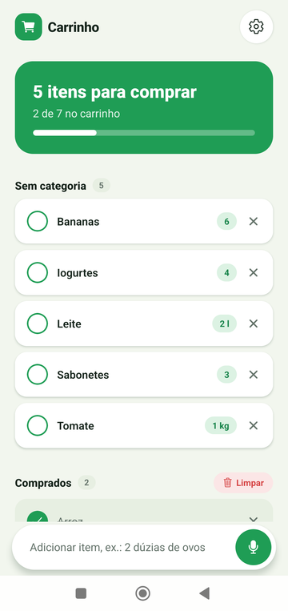
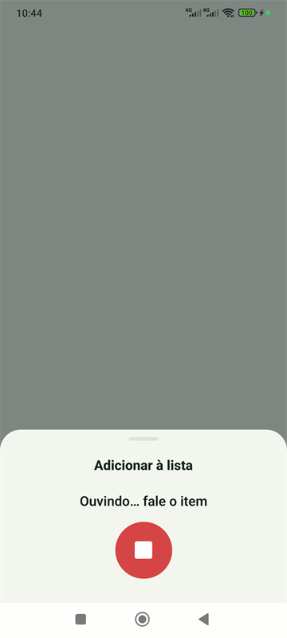
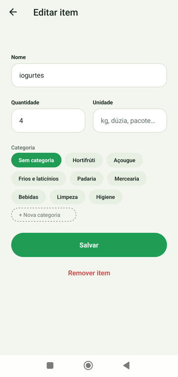
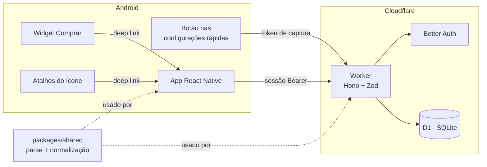
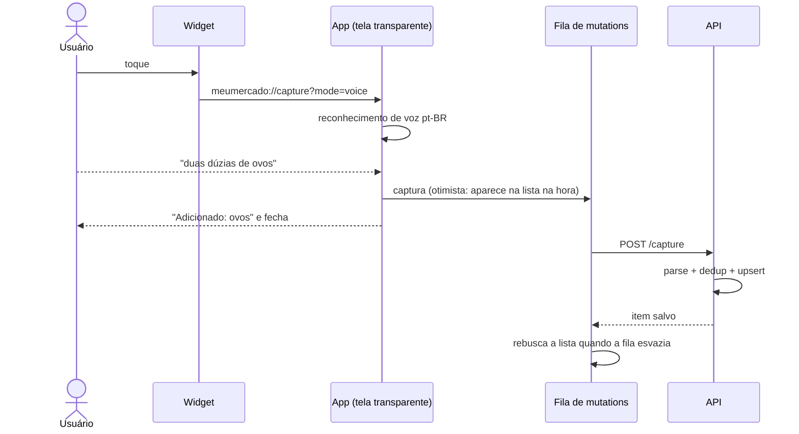

<div align="center">


# Carrinho

**Lista de compras para Android em que adicionar um item leva um toque e uma frase.**

Lembrou que acabou o café? Toque no widget, diga _"2 pacotes de café"_ e pronto: o app entende a
quantidade, junta com o que já estava na lista e funciona até sem internet.

[](https://github.com/unifkaraujo/carrinho/actions/workflows/ci.yml)


[](LICENSE)

</div>

<p align="center">
  
  &nbsp;
  
  &nbsp;
  
</p>

## Por que existe

Lista de compras falha no momento da captura: você lembra do item com as mãos ocupadas, longe do
app, e esquece. O Carrinho foi desenhado em volta disso, com várias portas de entrada que não exigem
abrir a lista:

| Entrada                          | Como funciona                                                                     |
| -------------------------------- | --------------------------------------------------------------------------------- |
| **Widget "Comprar"** (4x1 e 4x2) | Um toque abre o microfone; fala, salva e o app some sozinho                       |
| **Configurações rápidas**        | Botão no Centro de controle do Android, com um painel nativo em Kotlin            |
| **Atalhos do ícone**             | Segurar o ícone do app: _Adicionar por voz_ ou _Digitar item_                     |
| **Dentro do app**                | Barra de texto + voz, com edição de quantidade, unidade e categoria               |
| **API por token**                | `POST /capture` com token pessoal, para qualquer automação (Tasker, atalhos etc.) |

## Destaques

- **Entende linguagem natural em pt-BR.** _"duas dúzias de ovos"_, _"1,5 kg de carne"_,
  _"coloca leite na lista"_ viram `{ nome, quantidade, unidade }`, com números por extenso,
  vírgula decimal e unidades no plural.
- **Sem duplicatas.** _"Ovo"_, _"ovos"_ e _"OVOS"_ são o mesmo item (normalização sem acento e
  singularização com exceções do português). Falar de novo atualiza a quantidade; um item já
  comprado volta para a lista.
- **Offline de verdade.** O cache fica salvo no aparelho e as alterações entram numa fila em série
  que sobrevive ao fechamento do app e sincroniza quando a conexão volta.
- **Atualização otimista.** A tela responde na hora; o servidor continua sendo a fonte da verdade.
- **Multiusuário desde o início.** Todo dado pertence a um usuário, com sessão para o app e tokens de
  captura revogáveis para integrações.
- **Custo zero de infraestrutura.** API serverless sem servidor dormindo, banco SQLite gerenciado e
  nenhum cartão de crédito cadastrado.

## Arquitetura



A regra de negócio mais sensível, transformar uma frase em item e decidir se ela é duplicata, mora
em `packages/shared` e roda **igual no celular e no servidor**. Por isso a captura offline aplica
exatamente a mesma regra de duplicata que a API vai aplicar depois.

### Fluxo de uma captura por voz



## Stack

| Camada    | Tecnologia                                                        | Por quê                                                          |
| --------- | ----------------------------------------------------------------- | ---------------------------------------------------------------- |
| App       | Expo SDK 58, React Native 0.88, React 19 + React Compiler         | Um código TypeScript, módulos nativos quando precisa             |
| Navegação | expo-router (rotas tipadas, `Stack.Protected`)                    | Rotas por arquivo e proteção declarativa por estado de login     |
| Dados     | TanStack Query v5 + persistência em AsyncStorage                  | Cache, atualização otimista e fila offline no mesmo modelo       |
| Voz       | expo-speech-recognition                                           | Reconhecimento nativo do Android em pt-BR                        |
| Widget    | react-native-android-widget (+ patch próprio)                     | Widget declarado em JSX                                          |
| Nativo    | Módulo Expo local em **Kotlin** (`TileService` + `Activity`)      | Botão nas configurações rápidas com painel de captura próprio    |
| API       | Cloudflare Workers + Hono + Zod                                   | Grátis, sem cartão, sem servidor dormindo (essencial para voz)   |
| Banco     | Cloudflare D1 (SQLite) + Drizzle ORM + migrations                 | SQL de verdade, tipado e versionado                              |
| Auth      | Better Auth (e-mail/senha, plugin bearer) + hash PBKDF2 WebCrypto | Auth completo dentro do Worker, respeitando o limite de CPU      |
| Qualidade | TypeScript strict, ESLint (typescript-eslint strict), Prettier    | Regras estritas também para tamanho de função e nº de parâmetros |
| Testes    | Vitest                                                            | Domínio coberto no pacote compartilhado, na API e no app         |
| CI        | GitHub Actions                                                    | Tipos, lint, formatação e testes a cada push                     |

## Decisões técnicas que valem a leitura

<details>
<summary><b>Arquitetura por feature, com camadas dentro de cada uma</b></summary>

Cada feature (`items`, `capture`, `auth`, `capture-tokens`, `categories` na API; `shopping-list`,
`quick-capture`, `lock-screen-capture`… no app) tem `domain` puro, `data` com I/O, `use-cases`
para orquestrar e `http`/`hooks`/`components` nas bordas. Os use-cases recebem repositórios por
interface, então os testes da API usam repositórios em memória e não dependem do banco.

O projeto também segue convenções rígidas: um export principal por arquivo, funções com uma
responsabilidade (o ESLint limita a 30 linhas e 3 parâmetros) e nenhum comentário. O código precisa
se explicar pelos nomes.

</details>

<details>
<summary><b>Por que Cloudflare Workers e não Firebase, Render ou Supabase</b></summary>

Firebase Functions exige plano pago (Blaze). Render e Railway no plano grátis dormem, e um cold
start de vários segundos mata a experiência de "falar e pronto". O Supabase grátis pausa por
inatividade. Workers + D1 é gratuito, sem cartão e responde em milissegundos.

</details>

<details>
<summary><b>Hash de senha próprio por causa do limite de CPU</b></summary>

O plano grátis do Workers dá 10 ms de CPU por requisição, e o scrypt padrão do Better Auth estoura
isso. O projeto usa PBKDF2-SHA256 via WebCrypto (nativo do runtime) com iterações configuráveis. O
hash armazena as iterações usadas, então dá para mudar o custo sem invalidar senhas existentes.

</details>

<details>
<summary><b>Fila offline em série e o bug do "item que volta"</b></summary>

Todas as mutations da lista usam `setMutationDefaults` com chaves fixas e o mesmo `scope`. Assim
elas rodam em série, ficam pausadas offline e são retomadas mesmo depois de o app ser fechado (a
função não pode ser uma closure, senão não sobrevive à persistência).

Apagar vários itens rápido fazia alguns reaparecerem: cada mutation, ao terminar, rebuscava a lista
enquanto as outras ainda estavam na fila. Agora só a última mutation do escopo dispara a nova busca
(`is-last-pending-in-scope.ts`), com teste cobrindo o cenário.

</details>

<details>
<summary><b>Widget que parava de responder: patch na biblioteca</b></summary>

O clique do widget disparava um broadcast, e o app então abria a tela. Depois de o sistema encerrar
o app, o Android bloqueia abrir telas a partir do segundo plano, e o widget "morria". O
[patch](patches/react-native-android-widget+0.24.0.patch) troca isso por um
`PendingIntent.getActivity` direto. Ele é aplicado automaticamente pelo `patch-package` no
`postinstall`.

</details>

<details>
<summary><b>Cookies, React Native e a checagem de Origin</b></summary>

O app usa só token Bearer, mas o `fetch` do React Native guarda cookies sozinho. Requisições com
cookie e sem `Origin` são barradas pelo Better Auth (proteção contra CSRF), o que quebrava logout e
troca de senha. A API remove o header `Cookie` antes de chegar ao Better Auth
(`shared/http/strip-cookies.ts`).

</details>

<details>
<summary><b>Captura nas configurações rápidas, em Kotlin</b></summary>

`apps/mobile/modules/quick-settings-capture` é um módulo Expo local com um `TileService` e uma
`Activity` nativa: reconhece a voz, chama `POST /capture` e fecha, sem carregar o React Native. Ele
usa um token de captura próprio, criado pelo app depois do login e revogado automaticamente se
sobrar um antigo, e nunca exibe a lista.

Captura sem desbloquear não é possível no MIUI/HyperOS: o sistema exige o desbloqueio para abrir
telas a partir do Centro de controle e silencia o microfone de apps que não estão visíveis. Esse
limite está documentado no `CLAUDE.md`.

</details>

## Estrutura

```
apps/
  api/                    Cloudflare Worker
    src/features/<feature>/{domain,data,use-cases,http}
    migrations/           SQL gerado pelo drizzle-kit
  mobile/                 App Expo
    src/app/              rotas (expo-router), telas finas
    src/features/<feature>/{domain,data,hooks,components,screens}
    src/shared/           ui, query, http, form, storage
    modules/quick-settings-capture/   módulo nativo em Kotlin
packages/
  shared/                 parse de frases e normalização de nomes (app + API)
patches/                  correções em dependências (patch-package)
```

## Rodando localmente

Requisitos: Node 22 e, para o app, Android SDK + JDK 17.

```sh
npm install          # instala todos os workspaces e aplica os patches
npm run typecheck
npm run lint
npm test
```

**API** (`apps/api`), com D1 local:

```sh
npm run db:migrate:local
npm run dev                         # http://localhost:8787
```

**App** (`apps/mobile`). Ele usa módulos nativos, então não roda no Expo Go:

```sh
npx expo run:android                # dev build no celular via USB
```

APK de release:

```powershell
npx expo prebuild -p android
cd android
.\gradlew.bat assembleRelease -PreactNativeArchitectures=arm64-v8a
```

Para apontar o app para a API local, crie `apps/mobile/.env` com
`EXPO_PUBLIC_API_URL=http://<ip-do-computador>:8787`. Comandos de banco, deploy e tokens estão no
[`CLAUDE.md`](CLAUDE.md).

## API

| Método   | Rota                  | Descrição                                                    |
| -------- | --------------------- | ------------------------------------------------------------ |
| `POST`   | `/capture`            | Frase livre → item (parse, dedup e upsert). Sessão ou token  |
| `GET`    | `/items?status=`      | Lista os itens do usuário                                    |
| `PATCH`  | `/items/:id`          | Edita nome, quantidade, unidade, categoria ou status         |
| `DELETE` | `/items/:id`          | Remove um item                                               |
| `DELETE` | `/items/bought`       | Limpa os comprados                                           |
| `GET`    | `/categories`         | Categorias do usuário (padrões criadas no cadastro)          |
| `POST`   | `/capture-tokens`     | Cria token de captura (o valor só é mostrado uma vez)        |
| `DELETE` | `/capture-tokens/:id` | Revoga um token                                              |
| `*`      | `/api/auth/*`         | Better Auth: cadastro, login, logout, sessão, troca de senha |

```sh
curl -X POST https://<sua-api>/capture \
  -H "Authorization: Bearer mm_..." \
  -H "Content-Type: application/json" \
  -d '{"text":"2 dúzias de ovos"}'
# → 201 {"outcome":"created","message":"Adicionado: ovos","item":{"quantity":2,"unit":"dúzia",...}}
```

## Licença

[MIT](LICENSE) © Kaique Araujo
